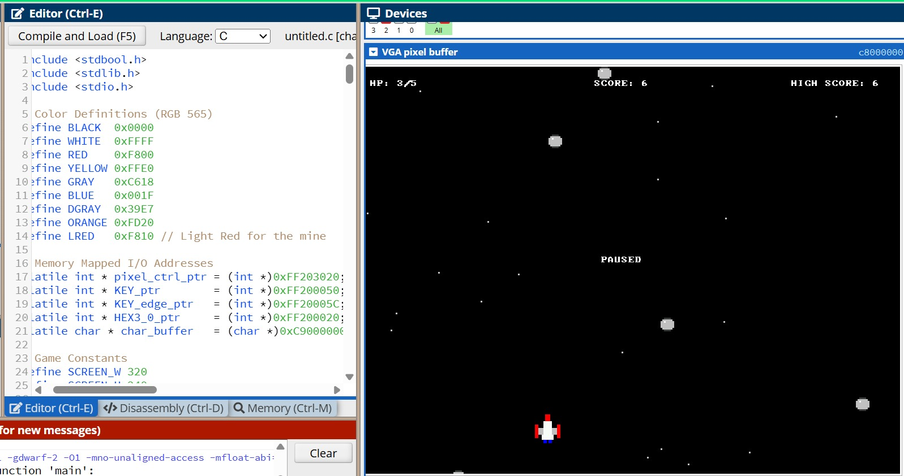

# Space Shooter (Nios II / DE1-SoC)

A real-time 2D space shooter written in C for the Nios II soft-core processor on the Intel DE1-SoC system. It was built as a course project in April 2026 for for the Computer Architecture course at IIT Patna and runs in the CPUlator Nios II simulator.

## Run it

No hardware needed.

1. Open the [CPUlator Nios II (DE1-SoC) simulator](https://cpulator.01xz.net/?sys=nios-de1soc).
2. In the **Editor** tab, set the language to **C** and paste the contents of `main.c`.
3. Click **Compile and Load**, then **Continue** (F3).
4. Scroll the **Devices** panel down to the **VGA pixel buffer** and **Character buffer** to see the game. Click the **Push buttons** to play.

## Controls

| Button | Action |
|--------|--------|
| KEY0 | Start / pause / resume / restart |
| KEY1 | Shoot (triple shot) |
| KEY2 | Move right |
| KEY3 | Move left |

## Features

- Asteroids that fall faster as your score rises (difficulty step at 15 points)
- Mines: rarer enemies worth 3 points that destroy the ship instantly on contact
- Triple-shot weapon fired from three positions on the ship
- 5 HP, shown on the 7-segment display, with a red screen flash on hit
- Explosion animations, a scrolling star field, pause, restart and high score
- On-screen HP, score, high score and status text via the character buffer

## How it works

- **Display:** 320x240 pixel buffer, 16-bit RGB565 colour, drawn with a custom `plot_pixel` and shape helpers (box, circle, sprites built from rectangles).
- **Frame sync:** the game loop ends each frame with `wait_for_vsync()`, which writes to the pixel controller's buffer register and polls the status bit.
- **Efficient redraw:** each frame erases and redraws only the objects that moved, instead of clearing the whole screen.
- **Entity pools:** fixed-size arrays for asteroids, bullets, explosions and stars, so there is no dynamic allocation in the loop.
- **Collision detection:** axis-aligned bounding-box checks for bullets vs. asteroids and asteroids vs. the ship.
- **Input:** pushbuttons are read through the edge-capture register, so each press registers once.
- **Memory-mapped I/O:** device pointers are `volatile`, so the compiler emits uncached I/O stores (`sthio`).

### Memory map used

| Device | Address |
|--------|---------|
| VGA pixel buffer | `0x08000000` |
| Character buffer | `0x09000000` |
| Pixel buffer controller | `0xFF203020` |
| Pushbuttons (data / edge capture) | `0xFF200050` / `0xFF20005C` |
| 7-segment displays (HEX3-0) | `0xFF200020` |

## Notes

- Targets the **Nios II** system in CPUlator. The character buffer address differs from the ARM version of the board (`0xC9000000`).
- Fixed during development: a CPUlator warning about cached stores to the pixel buffer (resolved with a `volatile` pointer), and a wrong character buffer address (the ARM address was used on Nios II).

## Credits
Course project for Computer Architecture Course at IIT Patna, April 2026.